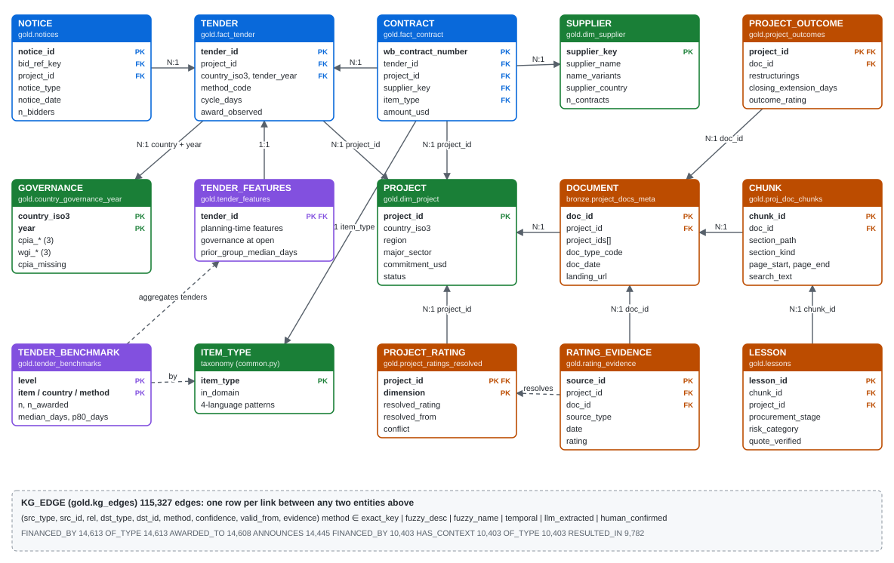

# Deliverable 1: Data Model

**Procurement Intelligence Platform: how structured, semi-structured and unstructured World Bank data fit together**

| Item | Detail |
|---|---|
| Physical platform | Databricks Delta tables in Unity Catalog, catalog `proc_demo`: `bronze`, `silver`, `gold`, `ai`, `ops` schemas |
| Try it | chatbot: https://dmlaishu.github.io/procurement-intelligence/chat/ |
| Domain | Medical laboratory and diagnostic equipment in World Bank-financed health projects |
| Verified on | local prototype run on public World Bank data, 26 October 2026 (row counts below are from that run); the same tables were built on Databricks on 2026-10-27 (§10) |
| Companion files | `er_diagram.svg` (diagram), `01_DATA_MODEL_DDL.sql` (full Gold DDL with keys and column comments) |

## 1. Design principles

1. **One conformed spine of keys.** Every source is reduced to a small set of shared identifiers: **Project ID**
   (P-code), **tender_id** (normalised bid reference), **supplier_key** (resolved supplier), **item_type**
   (equipment type), **doc_id / chunk_id** and **country_iso3 + year** (with region). Every question that crosses
   silos crosses through these keys. The hierarchy users navigate is Region → Country → Project → Tender →
   Contract → Supplier → Equipment type, with documents, passages, lessons and ratings attached to the project.
2. **A star schema for "what happened", a document hierarchy for "why".** Tenders and contracts are facts. Projects,
   suppliers and country-year governance are dimensions. Documents go *document → chunk → lesson / rating evidence*,
   so every lesson carries its page and section for citation.
3. **Links are data, with provenance.** Joins that are not exact (fuzzy supplier names, description-matched
   contracts, LLM-extracted lessons) are stored as rows in a **knowledge-graph edge table** with `method` and
   `confidence`. A user, a model or the verifier can therefore always ask *how sure is this link?*
4. **Time-aware.** Every fact carries the date it became known. Governance scores are forward-filled, never
   back-filled, and features use only information available at invitation time. This prevents leakage into models.
5. **Missing is explicit.** Open tenders are kept as censored (`award_observed = false`), unknown outcomes are flagged
   (`outcome_unknown`), and missing CPIA is a flag (`cpia_missing`), not a zero.

## 2. Entity-relationship diagram



<p class="legend"><span><i style="background:#0969da"></i>Facts (what happened)</span><span><i style="background:#1a7f37"></i>Dimensions</span>
<span><i style="background:#bc4c00"></i>Documents and knowledge (how / why)</span><span><i style="background:#8250df"></i>Analytical (model features, benchmarks)</span></p>

Arrows point from the many side to the one side. Dashed lines are derivations, not foreign keys. `DOCUMENT` is
`bronze.project_docs_meta`; in the local prototype the same rows live in `data/raw/documents_meta.json`
(131 documents: ISR 36, PP 36, PAD 30, ICR 17, ICRR 12). `ITEM_TYPE` is a reference
taxonomy rather than a table: every contract and tender carries its `item_type` and an `in_domain` flag.

## 3. Layers

| Layer | Tables | Role |
|---|---|---|
| **Bronze** | `contract_awards_raw`, `proc_notices_raw`, `projects_raw`, `governance_raw`, `country_ref`, `domain_projects`, `project_docs_meta` + volume `raw_docs`; `rag_documents` + volume `rag_docs` (§7.1) | API records and PDFs exactly as received, with ingest timestamp; Change Data Feed on |
| **Silver** | `contracts`, `notices`, `projects`, `governance`, `tenders`, `proj_doc_pages`, `rag_pages` | typed, de-duplicated, keys normalised (ISO codes, bid references, supplier names); one page of text per row |
| **Gold** | facts, dimensions, documents and knowledge, ML tables, `kg_edges` (below), view `v_lab_contracts`, `rag_chunks` (§7.1) | resolved entities and links; what the models, the vector indexes, the copilot and the chatbot read |
| **AI** | UC function tools (`proc_*`), vector indexes `proj_doc_chunks_index` and `rag_chunks_index`, registered models `proc_*` | what the copilot and chatbot call; governed by Unity Catalog grants |
| **Ops** | `app_logs`, `proc_briefs`, `proc_feedback`, `v_proc_kpis`, `rag_countries`, `rag_eval_results` | run log, every brief generated, user feedback, realised award dates, the country registry of the document Q&A and its evaluation history |

## 4. Table catalogue

| Table | Layer | Grain (one row per) | Primary key | Foreign keys / joins | Rows (prototype) | Source |
|---|---|---|---|---|---|---|
| `notices` | Gold (silver.notices) | one procurement notice | `notice_id` | bid_ref_key → fact_tender; project_id → dim_project | 15,158 | Procurement Notices API |
| `fact_tender` | Gold | one tender (bid reference), from invitation to award | `tender_id` | project_id; (country_iso3, tender_year) → governance; supplier_key | 10,403 | built from notices |
| `fact_contract` | Gold | one contract-supplier row | `wb_contract_number + supplier_key` | tender_id; project_id; supplier_key | 14,613 | Major Contract Awards (FinancesOne) |
| `dim_supplier` | Gold | one resolved supplier | `supplier_key` | - | 7,540 | resolved from contract supplier names |
| `dim_project` | Gold | one project | `project_id` | country_iso3 | 179 | Projects API |
| `country_governance_year` | Gold | country × year | `(country_iso3, year)` | - | 1,290 | WDI API: CPIA + WGI |
| `project_docs_meta` | Bronze | one project document | `doc_id` | project_id (project_ids[] for PPARs) | 131 | Documents & Reports API |
| `proj_doc_pages` | Silver | document page | `(doc_id, page_num)` | doc_id | (Databricks only) | PDF text |
| `proj_doc_chunks` | Gold | section-bounded passage (≤ 450 words) | `chunk_id` | doc_id; project_id | 6,187 | parsed PDFs |
| `lessons` | Gold | one lesson learned | `lesson_id` | chunk_id; doc_id; project_id | 150 | Lessons / Key factors sections |
| `rating_evidence` | Gold | one dated DO / IP rating | `source_id + dimension` | project_id; doc_id | 301 | ICR data sheets, ISRs, PPARs |
| `project_ratings_resolved` | Gold | project × rating dimension | `(project_id, dimension)` | project_id | 34 | rating_evidence |
| `project_outcomes` | Gold | one completed project | `project_id` | doc_id | 17 | ICR data sheet |
| `tender_features` | Gold (ML) | one tender with ≥ invitation date | `tender_id` | tender_id | 1,632 | fact_tender + project + governance |
| `tender_benchmarks` | Gold (ML) | benchmark cohort | `(level, country, category, method)` | - | 67 | Kaplan-Meier over fact_tender |
| `item_types` | Reference | one equipment type | `item_type` | - | 14 | taxonomy in procurement_demo/common.py |
| `kg_edges` | Gold | one typed link | `(src_type, src_id, rel, dst_type, dst_id)` | any entity ↔ any entity | 115,327 | all of the above |
| `proc_briefs` | Ops | one generated brief | `brief_id` | evidence_ids[] → any entity | (Databricks only) | copilot |
| `proc_feedback` | Ops | feedback on a brief / evidence item | `(brief_id, evidence_id, created_ts)` | brief_id | (Databricks only) | users; realised award dates |

## 5. How disjoint keys are reconciled

| Link | Rule | Edge `method` / confidence | Prototype result |
|---|---|---|---|
| Notice → Tender | normalised bid reference (`KE-MOWASCO-16771-CW-RFB` ≡ `KEMOWASCO16771CWRFB`) | `exact_key` / 1.0 | 10,403 tenders |
| Contract → Tender | (1) normalised borrower contract reference = bid reference; (2) else same project + category, signed ≤ 18 months after invitation, description token Jaccard ≥ 0.5 | `exact_key` 1.0 / `fuzzy_desc` = similarity | 9,600 exact + 182 fuzzy = **67%** of contracts |
| Contract → Supplier | normalised name key (drops M/S, legal forms, punctuation); within blocks of country + first token, similarity ≥ 0.92 → union-find merge | `exact_key` / `fuzzy_name` | 7,835 raw names → **7,540** suppliers (94 fuzzy merges) |
| Contract / Tender → Equipment type | description classified by an ordered taxonomy of patterns in English, French, Spanish and Portuguese (tolerant of garbled accents); generic classes are blocked for vehicles, CCTV and printing | `keyword` / 0.7 | 2,220 of 14,613 contracts are laboratory or diagnostic equipment |
| Contract / Tender / Document → Project | Project ID; PPARs covering several projects fan out to each | `exact_key` | **100%** of contracts |
| Tender → Governance | country + year of invitation, forward-filled ≤ 3 years | `temporal` | all tenders |
| Lesson → Chunk → Document → Project | lesson keeps its chunk and page; chunk keeps its document | `rule_numbered_paragraph` (local) / `llm_extracted` (Databricks) | 150 lessons, 147 quote-verified |
| Country identifiers | ISO-2 ↔ ISO-3 ↔ names in notices (incl. "Viet Nam" / "Vietnam") | alias table | - |

Matches with confidence between 0.6 and 0.9 go to a review queue. Confirmed decisions are written back as
`method = 'human_confirmed'` and reused.

## 6. Knowledge graph (`gold.kg_edges`)

The relational tables answer known questions fast. The edge table answers *path* questions: "which lessons come from
projects where this supplier won Works contracts?". It is a property graph stored as one Delta table, clustered by
`(rel, dst_id)` for reverse lookups. No separate graph database is needed at this scale.

| From → To | Relationship | Edges |
|---|---|---|
| CONTRACT → PROJECT | `FINANCED_BY` | 14,613 |
| CONTRACT → ITEM_TYPE | `OF_TYPE` | 14,613 |
| CONTRACT → SUPPLIER | `AWARDED_TO` | 14,608 |
| NOTICE → TENDER | `ANNOUNCES` | 14,445 |
| TENDER → PROJECT | `FINANCED_BY` | 10,403 |
| TENDER → GOVERNANCE | `HAS_CONTEXT` | 10,403 |
| TENDER → ITEM_TYPE | `OF_TYPE` | 10,403 |
| TENDER → CONTRACT | `RESULTED_IN` | 9,782 |
| PROJECT → SECTOR | `IN_SECTOR` | 7,540 |
| SUPPLIER → COUNTRY | `BASED_IN` | 7,540 |
| PROJECT → COUNTRY | `LOCATED_IN` | 179 |
| LESSON → STAGE | `AT_STAGE` | 167 |
| LESSON → PROJECT | `ABOUT` | 150 |
| LESSON → CHUNK | `FROM` | 150 |
| DOCUMENT → PROJECT | `DESCRIBES` | 131 |
| TENDER → STATE | `IN_STATE` | 109 |
| COUNTRY → REGION | `IN_REGION` | 87 |
| PROJECT → STATE | `LOCATED_IN` | 2 |
| STATE → COUNTRY | `PART_OF` | 2 |

**Total: 115,327 edges.** Three-hop example (contract → supplier → project → ICR lesson):

```sql
SELECT l.lesson, l.evidence_quote, l.title, l.page_start
FROM gold.kg_edges a                                                     -- CONTRACT -AWARDED_TO-> SUPPLIER
JOIN gold.kg_edges f ON f.src_id = a.src_id AND f.rel = 'FINANCED_BY'    -- CONTRACT -FINANCED_BY-> PROJECT
JOIN gold.lessons  l ON l.project_id = f.dst_id AND l.quote_verified
JOIN gold.fact_contract c ON c.wb_contract_number = a.src_id AND c.procurement_category = 'Works'
WHERE a.rel = 'AWARDED_TO' AND a.dst_id = :supplier_key;
```

## 7. Document model (unstructured side)

```
DOCUMENT (PAD / ISR / ICR / PPAR, 60-150 pages)
  └─ PAGE            silver.proj_doc_pages     text per page, line breaks kept, running headers removed
      └─ CHUNK       gold.proj_doc_chunks      bounded by headings (Roman / letter / ANNEX), ≤ 450 words, 60 overlap
          │                                    section_path, section_kind, content_type, page_start-page_end
          ├─ LESSON          gold.lessons             verbatim evidence_quote checked against the chunk
          └─ (vector index)  search_text embedded     doc type | project | country | sector | date | section + text
  └─ DATA SHEET (ICR) → RATING_EVIDENCE (dated ISR/ICR/PPAR ratings) → PROJECT_RATING (resolved, conflict flag)
                      → PROJECT_OUTCOME (restructurings, closing extension, outcome ratings)
```

Prototype: 131 reports → 6,187 chunks → 150 lessons and
301 dated ratings.

### 7.1 Document Q&A by country

The document Q&A keeps its own, country-partitioned copy of the document hierarchy, so a country can be added or
refreshed without touching the others. It joins the rest of the model through **Project ID** and **country ISO-3**.

```
RAG_COUNTRY (ops.rag_countries)            iso3, iso2, name, pinned projects
  └─ RAG_DOCUMENT (bronze.rag_documents)   country + doc_id; doc type, title, date, project_id → dim_project, file in rag_docs/<country>/<type>/
      └─ PAGE (silver.rag_pages)           doc_id + page_num
          └─ PASSAGE (gold.rag_chunks)     chunk_id = <country>_<doc_id>_<order>; section, pages, text, 1/0 category columns
              └─ (ai.rag_chunks_index)     Vector Search on search_text, filtered by country and category
```

| Table | Grain (one row per) | Key | Joins | Rows |
|---|---|---|---|---|
| `ops.rag_countries` | country | `iso3` | - | 3 (local), 2 (Databricks) |
| `bronze.rag_documents` | country × document | `(country, doc_id)` | `project_id` → `dim_project` | 111 (local) |
| `silver.rag_pages` | document page | `(doc_id, page_num)` | `doc_id` → `rag_documents` | - |
| `gold.rag_chunks` | passage | `chunk_id` | `doc_id`, `country`, `project_id` | 4,761 (local), 3,795 (Databricks) |
| `ai.rag_chunks_index` | passage vector | `chunk_id` | synced from `gold.rag_chunks` | 11 category filters + country |

Category columns (`cat_*`, 1/0) mark which equipment types a passage mentions (the same taxonomy as `item_type`)
and whether it is about the procurement process; the chatbot's category menu filters on them.

## 8. Data dictionary

Null shares and examples are measured on the prototype tables. High null shares are expected where an event has not
happened yet (e.g. `award_date` for open tenders) or a field is not published for older projects.

### `gold.dim_project` (179 rows)

*Grain:* one project.

| Column | Type | Key | Null | Meaning | Example |
|---|---|---|---|---|---|
| `project_id` | STRING | PK | 0% | World Bank project ID (P-code). The conformed key that joins structured and unstructured data | <code>P149340</code> |
| `country_iso3` | STRING |  | 13% | Country, ISO 3166 alpha-3 (ISO-2 and spelling variants resolved via alias table) | <code>IND</code> |
| `project_name` | STRING |  | 24% | Project name | <code>Nagaland Health Project</code> |
| `approval_date` | DATE |  | 30% | Board approval date | <code>2016-12-19</code> |
| `closing_date` | DATE |  | 24% | Current closing date | <code>2024-06-30</code> |
| `status` | STRING |  | 24% | Active \| Closed \| Pipeline \| Dropped | <code>Closed</code> |
| `lending_instrument` | STRING |  | 24% | IPF, PforR, DPF, ... | <code>Investment Project Financing</code> |
| `commitment_usd` | DOUBLE |  | 24% | Total commitment (USD) | <code>48000000.0</code> |
| `env_category` | STRING |  | 63% | Environmental category A/B/C/F (older projects) | <code>B</code> |
| `es_risk_rating` | STRING |  | 100% | Environmental & social risk rating (ESF projects; NULL before ESF) |  |
| `major_sector` | STRING |  | 24% | Major sector of the project | <code>Health</code> |
| `implementing_agency` | STRING |  | 26% | Implementing agency | <code>Department of Health and Family Welfare, Governm…</code> |
| `project_url` | STRING |  | 0% | Project page | <code>https://projects.worldbank.org/en/projects-opera…</code> |
| `objective` | STRING |  | 0% | Project development objective |  |
| `region` | STRING |  | 2% | World Bank region of the borrower country | <code>South Asia</code> |
| `state` | STRING |  | 99% | Sub-national state (India scope only) | <code>Nagaland</code> |
| `n_tenders` | DOUBLE |  | 22% | Tenders observed for the project | <code>53.0</code> |
| `median_cycle_days` | DOUBLE |  | 41% | Median invitation-to-award days for the project's tenders | <code>208.0</code> |

### `gold.dim_supplier` (7,540 rows)

*Grain:* one resolved supplier.

| Column | Type | Key | Null | Meaning | Example |
|---|---|---|---|---|---|
| `supplier_key` | STRING | PK | 0% | Resolved supplier: normalised name key + supplier country (after fuzzy merge) | <code>b hler farma&#124;NI</code> |
| `supplier_name` | STRING |  | 0% | Supplier name as published | <code>BÜHLER FARMA, S.A.</code> |
| `name_variants` | STRING |  | 0% | JSON list of all raw spellings merged into this supplier | <code>[&quot;B\u00dcHLER FARMA, S.A.&quot;]</code> |
| `n_contracts` | BIGINT |  | 0% | Contracts awarded to this supplier | <code>9</code> |
| `total_usd` | DOUBLE |  | 0% | Total awarded value (USD) | <code>1305730.25</code> |
| `supplier_country` | STRING |  | 0% | Supplier country | <code>Nicaragua</code> |

### `gold.country_governance_year` (1,290 rows)

*Grain:* country × year.

| Column | Type | Key | Null | Meaning | Example |
|---|---|---|---|---|---|
| `country_iso3` | STRING | PK | 0% | Country, ISO 3166 alpha-3 (ISO-2 and spelling variants resolved via alias table) | <code>RWA</code> |
| `year` | BIGINT | PK | 0% | Calendar year of the indicator (forward-filled ≤ 3 years, never back-filled) | <code>2017</code> |
| `cpia_budget_financial_mgmt` | DOUBLE |  | 34% | CPIA quality of budgetary and financial management (1-6) | <code>4.0</code> |
| `cpia_public_sector_mgmt` | DOUBLE |  | 34% | CPIA public sector management and institutions cluster (1-6) | <code>3.7</code> |
| `cpia_transparency_corruption` | DOUBLE |  | 34% | CPIA transparency, accountability and corruption (1-6) | <code>3.5</code> |
| `wgi_control_of_corruption` | DOUBLE |  | 0% | WGI control of corruption (about -2.5 to 2.5) | <code>0.5040962</code> |
| `wgi_gov_effectiveness` | DOUBLE |  | 0% | WGI government effectiveness | <code>0.3584605</code> |
| `wgi_regulatory_quality` | DOUBLE |  | 0% | WGI regulatory quality | <code>0.1621531</code> |
| `cpia_missing` | BIGINT |  | 0% | 1 when CPIA is not published (non-IDA countries) | <code>0</code> |

### `gold.notices` (15,158 rows)

*Grain:* one procurement notice.

| Column | Type | Key | Null | Meaning | Example |
|---|---|---|---|---|---|
| `notice_id` | STRING | PK | 0% | Procurement notice id (OP...) | <code>OP00241332</code> |
| `country_iso3` | STRING |  | 18% | Country, ISO 3166 alpha-3 (ISO-2 and spelling variants resolved via alias table) | <code>KEN</code> |
| `notice_type` | STRING |  | 0% | Invitation for Bids, Request for Expression of Interest, Contract Award, ... | <code>Contract Award</code> |
| `notice_date` | DATE |  | 0% | Publication date of the notice | <code>2023-08-09</code> |
| `deadline_date` | DATE |  | 89% | Bid / EOI submission deadline | <code>2023-04-06</code> |
| `project_id` | STRING |  | 0% | World Bank project ID (P-code). The conformed key that joins structured and unstructured data | <code>P152394</code> |
| `bid_ref` | STRING |  | 0% | Borrower bid reference as published | <code>KE-HOMABAY COUNTY-269732-GO-RFQ</code> |
| `description` | STRING |  | 0% | Free-text description of the package / contract | <code>SUPPLY OF 1NO. ANAESTHETIC MACHINE</code> |
| `procurement_category` | STRING |  | 2% | Works \| Goods \| Consultant Services \| Non-consulting Services | <code>Goods</code> |
| `method_code` | STRING |  | 0% | Method code: RFB, RFQ, QCBS, CQS, INDV, DIR, ... | <code>RFQ</code> |
| `method_name` | STRING |  | 0% | Method as published on the notice | <code>Request for Quotations</code> |
| `implementing_org` | STRING |  | 88% | Implementing agency named on the notice | <code>Project Coordination Unit (PCU)</code> |
| `rebid_text` | BOOLEAN |  | 0% | Notice text indicates a re-tender / re-advertisement | <code>False</code> |
| `award_date` | DATE |  | 62% | Earliest contract-award notice date | <code>2021-05-20</code> |
| `n_bidders` | DOUBLE |  | 12% | Number of bids / proposals received (award notice) | <code>3.0</code> |
| `n_rejected` | DOUBLE |  | 12% | Number of bids rejected (award notice) | <code>0.0</code> |
| `rejection_reasons` | STRING |  | 12% | Reasons for rejection, as published |  |
| `awarded_names` | STRING |  | 12% | Awarded firm(s) named on the award notice | <code>PHISSIAL ENTERPRISES</code> |
| `contract_duration_months` | DOUBLE |  | 13% | Contract duration on the award notice | <code>3.0</code> |
| `notice_version` | DOUBLE |  | 13% | Amendment counter of the award notice | <code>1.0</code> |
| `bid_ref_key` | STRING |  | 3% | Normalised bid reference; equals tender_id | <code>KEHOMABAYCOUNTY269732GORFQ</code> |

### `gold.fact_tender` (10,403 rows)

*Grain:* one tender (bid reference), from invitation to award.

| Column | Type | Key | Null | Meaning | Example |
|---|---|---|---|---|---|
| `tender_id` | STRING | PK | 0% | Normalised bid reference (upper-case, punctuation removed); the tender's identity | <code>JKMSCLOTAUTOCLAVESINGLEBIN09</code> |
| `open_date` | DATE |  | 84% | First invitation (IFB / REOI) date: start of the procurement cycle | <code>2020-12-23</code> |
| `deadline_date` | DATE |  | 85% | Bid / EOI submission deadline | <code>2021-01-09</code> |
| `n_invitations` | BIGINT |  | 0% | Number of invitation notices for the same bid reference (re-advertisements) | <code>1</code> |
| `project_id` | STRING | FK | 0% | World Bank project ID (P-code). The conformed key that joins structured and unstructured data | <code>P154990</code> |
| `country_iso3` | STRING |  | 19% | Country, ISO 3166 alpha-3 (ISO-2 and spelling variants resolved via alias table) | <code>IND</code> |
| `procurement_category` | STRING |  | 1% | Works \| Goods \| Consultant Services \| Non-consulting Services | <code>Goods</code> |
| `procurement_method` | STRING |  | 0% | Full method name (Request for Bids, QCBS, ...) | <code>Request for Bids</code> |
| `method_code` | STRING |  | 0% | Method code: RFB, RFQ, QCBS, CQS, INDV, DIR, ... | <code>RFB</code> |
| `description` | STRING |  | 0% | Free-text description of the package / contract | <code>Procurement of 100 No. Autoclave Vertical Single…</code> |
| `implementing_org` | STRING |  | 84% | Implementing agency named on the notice | <code>Jammu and Kashmir Medical Supplies Corporation L…</code> |
| `open_notice_type` | STRING |  | 84% | Type of the opening notice | <code>Invitation for Bids</code> |
| `award_date` | DATE |  | 5% | Earliest contract-award notice date | <code>2021-06-21</code> |
| `n_bidders` | DOUBLE |  | 5% | Number of bids / proposals received (award notice) | <code>1.0</code> |
| `n_rejected` | DOUBLE |  | 5% | Number of bids rejected (award notice) | <code>0.0</code> |
| `rejection_reasons` | STRING |  | 5% | Reasons for rejection, as published |  |
| `awarded_names` | STRING |  | 5% | Awarded firm(s) named on the award notice | <code>NEW ALPINE TRADERS</code> |
| `contract_duration_months` | DOUBLE |  | 7% | Contract duration on the award notice | <code>2.0</code> |
| `rebid_flag` | BOOLEAN |  | 0% | Target: re-tendered (re-advertised or flagged as re-tender) | <code>False</code> |
| `award_amended_flag` | BOOLEAN |  | 0% | Award notice was amended | <code>False</code> |
| `award_observed` | BOOLEAN |  | 0% | An award notice exists (event observed) | <code>True</code> |
| `observed_days` | DOUBLE |  | 90% | Days from open to award, or to the data cut if still open (survival time) | <code>180.0</code> |
| `outcome_unknown` | BOOLEAN |  | 0% | No award after 2 years: excluded as unknown outcome, not censored | <code>False</code> |
| `cycle_days` | DOUBLE |  | 89% | Target: days from invitation to award (awarded tenders only) | <code>180.0</code> |
| `bid_window_days` | DOUBLE |  | 85% | Days between invitation and submission deadline | <code>17.0</code> |
| `single_bid_flag` | DOUBLE |  | 5% | Target: exactly one responsive bid | <code>1.0</code> |
| `rejected_share` | DOUBLE |  | 27% | Share of bids rejected | <code>0.0</code> |
| `tender_year` | DOUBLE |  | 0% | Year of invitation (joins governance by country + year) | <code>2020.0</code> |
| `review_type` | STRING |  | 20% | Prior \| Post review by the Bank ('unknown' when not published) | <code>Post</code> |
| `contract_usd` | DOUBLE |  | 20% | Awarded contract value (from the linked contract) | <code>100792.77</code> |
| `supplier_key` | STRING |  | 21% | Resolved supplier: normalised name key + supplier country (after fuzzy merge) | <code>new alpine traders&#124;IN</code> |
| `state_from` | STRING |  | 99% | Where the state came from: implementing agency or project | <code>agency</code> |
| `state` | STRING |  | 99% | Sub-national state (India scope only) | <code>Jammu and Kashmir</code> |
| `item_type` | STRING |  | 0% | What was bought, classified into the scope's taxonomy (e.g. PCR, imaging, reagents, analyzers) | <code>Biosafety, sterilization and cold chain</code> |
| `in_domain` | BOOLEAN |  | 0% | Item type belongs to the domain (laboratory and diagnostic equipment) | <code>True</code> |
| `region` | STRING |  | 2% | World Bank region of the borrower country | <code>South Asia</code> |

### `gold.fact_contract` (14,613 rows)

*Grain:* one contract-supplier row.

| Column | Type | Key | Null | Meaning | Example |
|---|---|---|---|---|---|
| `wb_contract_number` | STRING | PK | 0% | World Bank contract number | <code>1686395</code> |
| `supplier_id` | STRING |  | 0% | WB supplier id (kept as evidence; not trusted alone) | <code>640252</code> |
| `supplier_name` | STRING |  | 0% | Supplier name as published | <code>RAMIETECH SOLUTIONS</code> |
| `supplier_country` | STRING |  | 0% | Supplier country | <code>India</code> |
| `supplier_country_code` | STRING |  | 0% | Supplier country ISO-2 | <code>IN</code> |
| `project_id` | STRING | FK | 0% | World Bank project ID (P-code). The conformed key that joins structured and unstructured data | <code>P149340</code> |
| `project_name` | STRING |  | 0% | Project name | <code>Nagaland Health Project</code> |
| `country_iso3` | STRING |  | 12% | Country, ISO 3166 alpha-3 (ISO-2 and spelling variants resolved via alias table) | <code>IND</code> |
| `region` | STRING |  | 1% | World Bank region of the borrower country | <code>South Asia</code> |
| `fiscal_year` | BIGINT |  | 0% | WB fiscal year of the award | <code>2022</code> |
| `signing_date` | DATE |  | 0% | Contract signing date | <code>2022-01-18</code> |
| `procurement_category` | STRING |  | 0% | Works \| Goods \| Consultant Services \| Non-consulting Services | <code>Goods</code> |
| `procurement_method` | STRING |  | 0% | Full method name (Request for Bids, QCBS, ...) | <code>Request for Bids</code> |
| `review_type` | STRING |  | 0% | Prior \| Post review by the Bank ('unknown' when not published) | <code>Post</code> |
| `amount_usd` | DOUBLE |  | 0% | Contract amount (USD) | <code>475879.8</code> |
| `description` | STRING |  | 0% | Free-text description of the package / contract | <code>Supply and Installation of IT equipment and Netw…</code> |
| `borrower_ref` | STRING |  | 0% | Borrower contract reference as published | <code>NHP/PP/2021/A/005</code> |
| `borrower_ref_key` | STRING |  | 3% | Normalised borrower reference (exact-key link to tender_id) | <code>NHPPP2021A005</code> |
| `supplier_name_key` | STRING |  | 0% | Normalised supplier name (legal forms, M/S, punctuation removed) | <code>ramietech solutions</code> |
| `item_type` | STRING |  | 0% | What was bought, classified into the scope's taxonomy (e.g. PCR, imaging, reagents, analyzers) | <code>IT, furniture and vehicles</code> |
| `in_domain` | BOOLEAN |  | 0% | Item type belongs to the domain (laboratory and diagnostic equipment) | <code>False</code> |
| `supplier_key` | STRING | PK | 0% | Resolved supplier: normalised name key + supplier country (after fuzzy merge) | <code>ramietech solutions&#124;IN</code> |
| `tender_id` | STRING | FK | 33% | Normalised bid reference (upper-case, punctuation removed); the tender's identity | <code>NHPPP2021A005</code> |
| `tender_link_method` | STRING |  | 33% | How the contract was linked to its tender: exact_key \| fuzzy_desc | <code>exact_key</code> |
| `tender_link_confidence` | DOUBLE |  | 33% | Confidence of the tender link (1.0 exact; similarity otherwise) | <code>1.0</code> |
| `state` | STRING |  | 99% | Sub-national state (India scope only) | <code>Nagaland</code> |

### `gold.proj_doc_chunks` (6,187 rows)

*Grain:* section-bounded passage (≤ 450 words).

| Column | Type | Key | Null | Meaning | Example |
|---|---|---|---|---|---|
| `chunk_id` | STRING | PK | 0% | <doc_id>_<sequence>; one section-bounded passage | <code>34459657_0004</code> |
| `doc_id` | STRING |  | 0% | Documents & Reports API id (also the PDF file name) | <code>34459657</code> |
| `doc_type_code` | STRING |  | 0% | PAD \| ISR \| ICR \| PPAR \| PROC_PLAN | <code>ISR</code> |
| `project_id` | STRING |  | 0% | World Bank project ID (P-code). The conformed key that joins structured and unstructured data | <code>P180849</code> |
| `country_iso3` | STRING |  | 19% | Country, ISO 3166 alpha-3 (ISO-2 and spelling variants resolved via alias table) | <code>TUR</code> |
| `doc_date` | STRING |  | 0% | Document date | <code>2025-02-25</code> |
| `title` | STRING |  | 0% | Document title (used in citations) | <code>Disclosable Version of the ISR - Türkiye Earthqu…</code> |
| `landing_url` | STRING |  | 0% | Document page on documents.worldbank.org (citation link) | <code>http://documents.worldbank.org/curated/en/099022…</code> |
| `section_path` | STRING |  | 0% | Heading path of the chunk (e.g. 'V. LESSONS > B. ...') | <code>FRONT MATTER &gt; 4. KEY ISSUES &amp; STATUS</code> |
| `section_kind` | STRING |  | 0% | lessons \| key_factors \| procurement_fiduciary \| risk \| ratings \| results \| design \| annex \| other | <code>other</code> |
| `content_type` | STRING |  | 0% | narrative \| table \| annex | <code>narrative</code> |
| `page_start` | BIGINT |  | 0% | First page of the passage (citation) | <code>2</code> |
| `page_end` | BIGINT |  | 0% | Last page of the passage | <code>2</code> |
| `n_words` | BIGINT |  | 0% | Words in the chunk (≤ 450, 60 overlap) | <code>174</code> |
| `chunk_text` | STRING |  | 0% | Passage text, running headers removed | <code>4.1 Implementation Status and Key Decisions The …</code> |
| `search_text` | STRING |  | 0% | Contextual text that is embedded: doc type \| project \| country \| sector \| date \| section + text | <code>ISR &#124; Türkiye Earthquake Recovery and Reconstruc…</code> |

### `gold.lessons` (150 rows)

*Grain:* one lesson learned.

| Column | Type | Key | Null | Meaning | Example |
|---|---|---|---|---|---|
| `lesson_id` | STRING | PK | 0% | <doc_id>_L<n> | <code>34318883_L0071</code> |
| `doc_id` | STRING |  | 0% | Documents & Reports API id (also the PDF file name) | <code>34318883</code> |
| `chunk_id` | STRING | FK | 0% | <doc_id>_<sequence>; one section-bounded passage | <code>34318883_0046</code> |
| `project_id` | STRING |  | 0% | World Bank project ID (P-code). The conformed key that joins structured and unstructured data | <code>P157291</code> |
| `country_iso3` | STRING |  | 28% | Country, ISO 3166 alpha-3 (ISO-2 and spelling variants resolved via alias table) | <code>KHM</code> |
| `doc_type_code` | STRING |  | 0% | PAD \| ISR \| ICR \| PPAR \| PROC_PLAN | <code>ICR</code> |
| `section_kind` | STRING |  | 0% | lessons \| key_factors \| procurement_fiduciary \| risk \| ratings \| results \| design \| annex \| other | <code>key_factors</code> |
| `paragraph` | DOUBLE |  | 2% | Numbered paragraph in the report | <code>74.0</code> |
| `page_start` | BIGINT |  | 0% | First page of the passage (citation) | <code>27</code> |
| `lesson` | STRING |  | 0% | Lesson statement (first sentence) | <code>Construction of the two PRHs financed by the Pro…</code> |
| `detail` | STRING |  | 0% | Full paragraph | <code>Construction of the two PRHs financed by the Pro…</code> |
| `procurement_stage` | STRING |  | 0% | planning \| tender_design \| evaluation_award \| contract_management \| general | <code>planning;contract_management</code> |
| `risk_category` | STRING |  | 0% | delay \| capacity \| fiduciary \| safeguards \| cost_overrun \| specification \| other | <code>delay</code> |
| `procurement_related` | BOOLEAN |  | 0% | Lesson concerns procurement | <code>True</code> |
| `evidence_quote` | STRING |  | 0% | Verbatim quote; must be found in the source chunk | <code>Construction of the two PRHs financed by the Pro…</code> |
| `extraction_method` | STRING |  | 0% | rule_numbered_paragraph (local) \| llm_extracted (Databricks) | <code>rule_numbered_paragraph</code> |
| `quote_verified` | BOOLEAN |  | 0% | The quote was found verbatim in the source chunk (only verified lessons are served) | <code>True</code> |
| `title` | STRING |  | 0% | Document title (used in citations) | <code>Cambodia - Health Equity and Quality Improvement…</code> |
| `landing_url` | STRING |  | 0% | Document page on documents.worldbank.org (citation link) | <code>http://documents.worldbank.org/curated/en/099051…</code> |
| `doc_date` | STRING |  | 0% | Document date | <code>2024-05-15</code> |

### `gold.rating_evidence` (301 rows)

*Grain:* one dated DO / IP rating.

| Column | Type | Key | Null | Meaning | Example |
|---|---|---|---|---|---|
| `project_id` | STRING |  | 0% | World Bank project ID (P-code). The conformed key that joins structured and unstructured data | <code>P131825</code> |
| `dimension` | STRING |  | 0% | development_objective \| implementation_progress | <code>development_objective</code> |
| `source_type` | STRING |  | 0% | ISR \| ICR \| ICRR \| PPAR | <code>ISR</code> |
| `date` | DATE |  | 0% | Date of the rating | <code>2019-12-28</code> |
| `rating` | STRING |  | 0% | Highly Satisfactory ... Highly Unsatisfactory | <code>Moderately Satisfactory</code> |
| `source_id` | STRING |  | 0% | <doc_id>#ISR<n> etc.: the exact rating record | <code>33858328#ISR14</code> |
| `doc_id` | STRING |  | 0% | Documents & Reports API id (also the PDF file name) | <code>33858328</code> |
| `via` | STRING |  | 0% | Where it was parsed from (e.g. ICR data sheet) | <code>ICR data sheet</code> |

### `gold.project_ratings_resolved` (34 rows)

*Grain:* project × rating dimension.

| Column | Type | Key | Null | Meaning | Example |
|---|---|---|---|---|---|
| `project_id` | STRING | PK | 0% | World Bank project ID (P-code). The conformed key that joins structured and unstructured data | <code>P131825</code> |
| `dimension` | STRING | PK | 0% | development_objective \| implementation_progress | <code>development_objective</code> |
| `resolved_rating` | STRING |  | 0% | Rating after the evidence hierarchy is applied | <code>Moderately Satisfactory</code> |
| `resolved_from` | STRING |  | 0% | Source type that won (PPAR > ICRR > ICR > latest ISR) | <code>ICRR</code> |
| `resolved_source_id` | STRING |  | 0% | Record that won | <code>33921463</code> |
| `conflict` | BOOLEAN |  | 0% | Sources fall on opposite sides of the satisfactory line | <code>True</code> |
| `spread` | BIGINT |  | 0% | Rating steps between best and worst evidence | <code>3</code> |
| `n_evidence` | BIGINT |  | 0% | Number of rating records | <code>19</code> |
| `worst_isr` | STRING |  | 0% | Worst supervision rating during implementation | <code>Unsatisfactory</code> |
| `trajectory` | STRING |  | 0% | JSON list of (source, date, rating): kept so both sides can be cited | <code>[[&quot;ISR&quot;, &quot;2014-08-09&quot;, &quot;Satisfactory&quot;], [&quot;ISR&quot;, …</code> |

### `gold.project_outcomes` (17 rows)

*Grain:* one completed project.

| Column | Type | Key | Null | Meaning | Example |
|---|---|---|---|---|---|
| `project_id` | STRING | PK | 0% | World Bank project ID (P-code). The conformed key that joins structured and unstructured data | <code>P152799</code> |
| `doc_id` | STRING |  | 0% | Documents & Reports API id (also the PDF file name) | <code>34382469</code> |
| `restructurings` | BIGINT |  | 0% | Number of restructurings (ICR data sheet) | <code>4</code> |
| `closing_planned` | DATE |  | 59% | Original closing date | <code>2023-12-31</code> |
| `closing_actual` | DATE |  | 59% | Actual closing date | <code>2023-12-31</code> |
| `closing_extension_days` | DOUBLE |  | 59% | Days the closing date was extended | <code>0.0</code> |
| `outcome_rating` | STRING |  | 6% | Final outcome rating | <code>Moderately Satisfactory</code> |
| `bank_performance` | STRING |  | 6% | Bank performance rating | <code>Satisfactory</code> |
| `me_quality` | STRING |  | 6% | Quality of monitoring and evaluation | <code>Substantial</code> |
| `n_isr_ratings` | BIGINT |  | 0% | ISR ratings found in the data sheet | <code>17</code> |

### `gold.tender_features` (1,632 rows)

*Grain:* one tender with ≥ invitation date. Inherits every `fact_tender` column; only the added columns are listed.

| Column | Type | Key | Null | Meaning | Example |
|---|---|---|---|---|---|
| `commitment_usd` | DOUBLE |  | 14% | Total commitment (USD) | <code>36000000.0</code> |
| `approval_date` | DATE |  | 15% | Board approval date | <code>2020-06-23</code> |
| `env_category` | STRING |  | 0% | Environmental category A/B/C/F (older projects) | <code>B</code> |
| `es_risk_rating` | STRING |  | 0% | Environmental & social risk rating (ESF projects; NULL before ESF) | <code>missing</code> |
| `major_sector` | STRING |  | 0% | Major sector of the project | <code>Education</code> |
| `cpia_budget_financial_mgmt` | DOUBLE |  | 45% | CPIA quality of budgetary and financial management (1-6) | <code>4.0</code> |
| `cpia_public_sector_mgmt` | DOUBLE |  | 45% | CPIA public sector management and institutions cluster (1-6) | <code>3.2</code> |
| `cpia_transparency_corruption` | DOUBLE |  | 45% | CPIA transparency, accountability and corruption (1-6) | <code>3.0</code> |
| `wgi_control_of_corruption` | DOUBLE |  | 18% | WGI control of corruption (about -2.5 to 2.5) | <code>-1.0685743</code> |
| `wgi_gov_effectiveness` | DOUBLE |  | 18% | WGI government effectiveness | <code>-0.6059794</code> |
| `wgi_regulatory_quality` | DOUBLE |  | 18% | WGI regulatory quality | <code>-0.9179055</code> |
| `cpia_missing` | DOUBLE |  | 18% | 1 when CPIA is not published (non-IDA countries) | <code>0.0</code> |
| `log_contract_usd` | DOUBLE |  | 43% | log(1 + estimated value) | <code>8.743530038729363</code> |
| `log_commitment` | DOUBLE |  | 14% | log(1 + project commitment) | <code>17.399029524198163</code> |
| `project_age_days` | DOUBLE |  | 15% | Days from project approval to invitation | <code>1801.0</code> |
| `open_month` | INT |  | 0% | Month of invitation | <code>5</code> |
| `desc_words` | BIGINT |  | 0% | Words in the description | <code>12</code> |
| `kw_works_civil` | BIGINT |  | 0% | Description mentions works civil keywords (0/1) | <code>0</code> |
| `kw_supply` | BIGINT |  | 0% | Description mentions supply keywords (0/1) | <code>0</code> |
| `kw_consulting` | BIGINT |  | 0% | Description mentions consulting keywords (0/1) | <code>0</code> |
| `kw_it` | BIGINT |  | 0% | Description mentions it keywords (0/1) | <code>0</code> |
| `kw_vehicle` | BIGINT |  | 0% | Description mentions vehicle keywords (0/1) | <code>0</code> |
| `kw_lot` | BIGINT |  | 0% | Description mentions lot keywords (0/1) | <code>0</code> |
| `prior_group_median_days` | DOUBLE |  | 47% | Median cycle of earlier tenders in the same country/category/method (no leakage) | <code>48.0</code> |
| `prior_project_median_days` | DOUBLE |  | 43% | Median cycle of the project's earlier tenders | <code>31.0</code> |
| `prior_project_tenders` | BIGINT |  | 0% | Earlier tenders in the project | <code>49</code> |

### `gold.tender_benchmarks` (67 rows)

*Grain:* benchmark cohort.

| Column | Type | Key | Null | Meaning | Example |
|---|---|---|---|---|---|
| `level` | STRING |  | 0% | Fallback level: country+category+method → category+method → category | <code>country+category+method</code> |
| `country_iso3` | STRING |  | 51% | Country, ISO 3166 alpha-3 (ISO-2 and spelling variants resolved via alias table) | <code>BGD</code> |
| `procurement_category` | STRING |  | 45% | Works \| Goods \| Consultant Services \| Non-consulting Services | <code>Goods</code> |
| `method_code` | STRING |  | 21% | Method code: RFB, RFQ, QCBS, CQS, INDV, DIR, ... | <code>RFB</code> |
| `n` | BIGINT |  | 0% | Tenders in the cohort (awarded + censored) | <code>23</code> |
| `n_awarded` | BIGINT |  | 0% | Awarded tenders in the cohort | <code>23</code> |
| `median_days` | DOUBLE |  | 1% | Kaplan-Meier median days to award (censoring-aware) | <code>134.0</code> |
| `p80_days` | DOUBLE |  | 6% | Kaplan-Meier 80th percentile days to award (NULL when not reached) | <code>228.0</code> |
| `naive_median_awarded_only` | DOUBLE |  | 0% | Median when still-open tenders are ignored (shows the bias) | <code>134.0</code> |
| `item_type` | STRING |  | 55% | What was bought, classified into the scope's taxonomy (e.g. PCR, imaging, reagents, analyzers) | <code>Biosafety, sterilization and cold chain</code> |

### `gold.kg_edges` (115,327 rows)

*Grain:* one typed link.

| Column | Type | Key | Null | Meaning | Example |
|---|---|---|---|---|---|
| `src_type` | STRING |  | 0% | Source entity type | <code>CONTRACT</code> |
| `src_id` | STRING |  | 0% | Source entity id | <code>1755492</code> |
| `rel` | STRING |  | 0% | Relationship | <code>OF_TYPE</code> |
| `dst_type` | STRING |  | 0% | Target entity type | <code>ITEM_TYPE</code> |
| `dst_id` | STRING |  | 0% | Target entity id | <code>IT, furniture and vehicles</code> |
| `method` | STRING |  | 0% | exact_key \| fuzzy_desc \| fuzzy_name \| temporal \| llm_extracted \| human_confirmed \| rule_* | <code>keyword</code> |
| `confidence` | DOUBLE |  | 0% | 0-1 confidence of the link | <code>0.7</code> |


## 9. Physical design (Delta DDL)

The full DDL for all Gold tables is in `01_DATA_MODEL_DDL.sql`. Example:

```sql
CREATE TABLE IF NOT EXISTS gold.fact_contract (
  wb_contract_number             STRING NOT NULL COMMENT 'World Bank contract number',
  supplier_id                    STRING COMMENT 'WB supplier id (kept as evidence; not trusted alone)',
  supplier_name                  STRING COMMENT 'Supplier name as published',
  supplier_country               STRING COMMENT 'Supplier country',
  supplier_country_code          STRING COMMENT 'Supplier country ISO-2',
  project_id                     STRING COMMENT 'World Bank project ID (P-code). The conformed key that joins structured and unstructured data',
  project_name                   STRING COMMENT 'Project name',
  country_iso3                   STRING COMMENT 'Country, ISO 3166 alpha-3 (ISO-2 and spelling variants resolved via alias table)',
  region                         STRING COMMENT 'World Bank region of the borrower country',
  fiscal_year                    BIGINT COMMENT 'WB fiscal year of the award',
  signing_date                   DATE COMMENT 'Contract signing date',
  procurement_category           STRING COMMENT 'Works | Goods | Consultant Services | Non-consulting Services',
  procurement_method             STRING COMMENT 'Full method name (Request for Bids, QCBS, ...)',
  review_type                    STRING COMMENT 'Prior | Post review by the Bank (''unknown'' when not published)',
  amount_usd                     DOUBLE COMMENT 'Contract amount (USD)',
  description                    STRING COMMENT 'Free-text description of the package / contract',
  borrower_ref                   STRING COMMENT 'Borrower contract reference as published',
  borrower_ref_key               STRING COMMENT 'Normalised borrower reference (exact-key link to tender_id)',
  supplier_name_key              STRING COMMENT 'Normalised supplier name (legal forms, M/S, punctuation removed)',
  item_type                      STRING COMMENT 'What was bought, classified into the scope''s taxonomy (e.g. PCR, imaging, reagents, analyzers)',
  in_domain                      BOOLEAN COMMENT 'Item type belongs to the domain (laboratory and diagnostic equipment)',
  supplier_key                   STRING NOT NULL COMMENT 'Resolved supplier: normalised name key + supplier country (after fuzzy merge)',
  tender_id                      STRING COMMENT 'Normalised bid reference (upper-case, punctuation removed); the tender''s identity',
  tender_link_method             STRING COMMENT 'How the contract was linked to its tender: exact_key | fuzzy_desc',
  tender_link_confidence         DOUBLE COMMENT 'Confidence of the tender link (1.0 exact; similarity otherwise)',
  state                          STRING COMMENT 'Sub-national state (India scope only)',
  CONSTRAINT pk_fact_contract PRIMARY KEY (wb_contract_number, supplier_key) RELY,
  CONSTRAINT fk_fact_contract_tender_id FOREIGN KEY (tender_id) REFERENCES gold.fact_tender,
  CONSTRAINT fk_fact_contract_project_id FOREIGN KEY (project_id) REFERENCES gold.dim_project,
  CONSTRAINT fk_fact_contract_supplier_key FOREIGN KEY (supplier_key) REFERENCES gold.dim_supplier
)
CLUSTER BY (item_type, country_iso3)
COMMENT 'one contract-supplier row. Source: Major Contract Awards (FinancesOne)'
TBLPROPERTIES (delta.enableChangeDataFeed = true);
```

**Scaling.** The full public corpus is about 300k contract rows, about 425k notices, about 22k projects and tens of
thousands of documents. That is small for Delta. Liquid clustering on country and year keeps scans narrow, Change Data
Feed makes Silver → Gold and the vector index incremental, and supplier resolution uses blocking so it stays near-linear.

## 10. Built on Databricks

The model was created on Databricks on 2026-10-27 by notebooks 00 and 20-34, in catalog `proc_demo`:

| Object | Rows on Databricks |
|---|---|
| `bronze.contract_awards_raw` (Health Goods awards of the domain projects) | 14,622 |
| `bronze.domain_projects` | 179 |
| `bronze.proc_notices_raw` | 15,164 |
| `gold.v_lab_contracts` (lab and diagnostic contract rows) | 2,221 (US$1,375,796,408) |
| `gold.fact_tender` / with an invitation-to-award time | 10,407 / 1,068 |
| `gold.dim_supplier` | 7,543 |
| `bronze.project_docs_meta` / `gold.proj_doc_chunks` | 128 / 6,126 |
| `gold.lessons` (quote-verified) | 733 (712) |
| `gold.kg_edges` | 116,199 |
| `gold.rag_chunks` (KEN 1,239, IND 2,556) | 3,795 |
